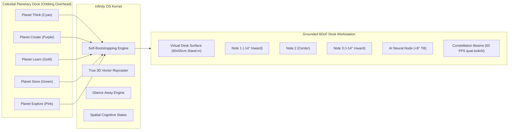

# INFINITY // Cosmic Spatial Operating System & Ambient Workstation

[](https://learn-specs.devpost.com/)
[](https://developers.specs.com/)
[](https://ar.snap.com/)
[](https://developers.specs.com/docs/clad)

> **Submission for Devpost Hackathon**: [Learn AR with SPECS](https://learn-specs.devpost.com/)  
> **Official Submission Project**: [`tt/tt.esproj`](tt/tt.esproj)  
> **Planning Documentation**: [`devpost/design-brief.md`](devpost/design-brief.md)

---

## The Spatial Computing Vision

Screens trap our most complex ideas inside tiny, flat, rectangular viewports. When designing architectures, creative workflows, or interconnected knowledge systems, human cognition requires **physical room space**.

**INFINITY** transforms any physical room into an ambient, 6DoF cosmic spatial workstation for **Snap Spectacles AR glasses**. Instead of floating a conventional 2D dashboard directly in front of the user's face, INFINITY grounds content in the physical environment through three core AR principles:

1. **Draws in the World**: A virtual desk surface plate physically grounds the workstation. Interactive sticky notes curve along an ergonomic **15° cylindrical arc** at natural reading distance (focus plane $Z = -68\text{ to } -92\text{ cm}$).
2. **Shares Your View**: A real-time **60 FPS Constellation Geometry Solver** computes 3D dynamic vector links connecting dependent ideas as physical beams that reorient and pulse in real space.
3. **Leaves Your Body Free**: Hands-free voice command interface paired with a **3D Voice HUD capsule** (`[ 🎙️ VOICE: "THINK" ➔ EXECUTING ]`), allowing ideation while keeping your body completely free.
4. **Respects Your Attention**: A built-in **Glance-Away Ambient Attenuation Engine** automatically dims the workspace to a subtle 20% silhouette whenever the user looks up or away, keeping physical human vision clear and unobstructed.



---

## Key Features

### 1. 5 Celestial Spatial Workspaces
Navigate between five specialized operating environments by pinching celestial planetary orbs orbiting overhead:
- **Think Workspace** (Cyberpunk Cyan `#00f0ff`): Creative ideation and decentralized 6DoF engine architecture.
- **Create Workspace** (Neon Purple `#b838ff`): Volumetric prototyping, glass transmission, and procedural shaders.
- **Learn Workspace** (Radiant Gold `#ffb000`): Biomechanical kinematics and SIK gaze/pinch ergonomics.
- **Store Workspace** (Neon Emerald `#00ffaa`): Persistent cross-session vault with coordinate restore.
- **Explore Workspace** (Neon Pink `#ff007f`): Infinite whiteboard navigation and deep-space concept traversal.

### 2. 15° Cylindrical Curved Ergonomics
Flat 2D planes cause focal distance fatigue on optical waveguides. INFINITY positions notes along a 15° cylindrical curvature concentric with the user's head:
- Left notes angle $+14^\circ$ inward toward the viewer.
- Right notes angle $-14^\circ$ inward toward the viewer.
- Bottom AI note pitches $+8^\circ$ upward.
- Typography scaled for waveguide legibility with high contrast over dark acrylic backers.

### 3. Spatial Cognitive States
Replaces traditional Kanban with spatial computing states:
- `ANCHORED` (Emerald Green `#00ffaa`): Pinned to physical room coordinates.
- `SYNTHESIZING` (Radiant Gold `#ffb000`): Active neural AI thought stream.
- `SYNCHRONIZED` (Cyberpunk Cyan `#00f0ff`): Cross-device vault state.
- Tap or pinch any note to cycle its cognitive state in real-time.

### 4. True 3D Vector Raycast Interaction
Zero 2D screen-space pixel approximations. Uses `screenSpaceToRay` to calculate true 3D spatial distances to object centers, providing:
- **+14% Hover Scale Feedback**: Notes smoothly expand and illuminate when aimed at.
- **Pinch-and-Drag Manipulation**: Move notes anywhere across the 3D desk plane.
- **Dynamic Constellation Recalculation**: Beams stretch, rotate, and pulse in real-time.

### 5. Holographic AI Assistant & Spatial Audio Visualizer
Pinching the pulsating AI core triggers neural idea synthesis, updating the AI note, pulsing the constellation beams with energy, and triggering an expanding **Audio Ripple Wave** (`Torus.mesh`).

### 6. Glasses-Native Modular Architecture
All core capabilities have been engineered into modular, glasses-first AR subsystems:
- **Note Editing & Spatial Keyboard Deck**: Select any note to summon a floating 3D editor easel with an angled alphanumeric keycap deck (`NoteEditorKeyboardModule.js`).
- **Freehand Inking & Geometric Hold-to-Snap**: Real-time 3D stroke capture with automatic recognition of circles, rectangles, and lines (`DrawingAndSnappingModule.js`, `ShapeRecognizerModule.js`).
- **FTUE 3-Step Interactive Tutorial**: Holographic onboarding billboard guiding users through pinch-drag, note editing, and AI synthesis (`FTUEOnboardingModule.js`).
- **Session Exporter**: Compiles notes, cognitive states, and snapped drawings into clean Markdown and JSON reports stored to wearable persistence (`SessionExporterModule.js`).
- **Desktop Companion Sync**: Ingests external desktop snippets and clipboard cards into AR without turning the experience into a flat monitor (`DesktopCompanionSyncModule.js`).

---

## Project Structure & Submission Deliverables

```text
spatial_computer/
├── tt/                               # Official Snap Spectacles Project
│   ├── tt.esproj                     # Lens Studio 5.24 project manifest
│   ├── .mcp.json                     # Lens Studio MCP bridge configuration
│   ├── CLAUDE.md / AGENTS.md         # Agent rules and SIK specifications
│   ├── Assets/                       # Native 3D assets & scripts
│   │   ├── Untitled JavaScript Component.js # Autonomous Kernel Orchestrator
│   │   ├── InfinityOSKernel.js       # Synced primary script
│   │   ├── NoteEditorKeyboardModule.js # 3D Note Editor Easel & Keyboard
│   │   ├── DrawingAndSnappingModule.js # 3D Polyline Inking & Shape Snapper
│   │   ├── ShapeRecognizerModule.js  # 1:1 Geometric Recognition Engine
│   │   ├── FTUEOnboardingModule.js   # 3-Step Holographic Tutorial Engine
│   │   ├── SessionExporterModule.js  # Markdown & JSON Session Vault Exporter
│   │   ├── LiveAIAssistantModule.js  # Contextual AI Synthesis Bridge
│   │   ├── DesktopCompanionSyncModule.js # External Ingestion Bridge
│   │   ├── Tests/                    # LEAF Test Suite
│   │   │   └── InfinityScenarios.ts  # 7 Registered LEAF Scenarios
│   │   ├── Scene.scene               # Scene hierarchy & asset bindings
│   │   ├── Box.mesh, Sphere.mesh, Torus.mesh
│   │   └── Planet_*.png, Sticky_*.png, Whiteboard_Glass.png
│   └── Packages/                     # Spectacles Interaction Kit & LEAF
├── devpost/                          # Required Devpost Learn Planning Docs
│   └── design-brief.md               # Approved Hackathon Design Brief
├── tests/                            # Automated Verification Test Suite
│   ├── test_lens_studio_port.py      # Automated 3D math & compliance tests
│   └── test_spectacles_features.py   # Native Spectacles feature verification
└── README.md                         # This file
```

---

## How to Run in Lens Studio 5.24 Preview

1. Open **Lens Studio 5.24.1**.
2. Select **File > Open Project** and choose [`tt/tt.esproj`](tt/tt.esproj).
3. Open the **Interactive Preview** panel:
   - **WASD / Mouse Look**: Walk around the virtual room and observe the desk and notes physically anchored with real 6DoF parallax.
   - **Hover Aim**: Move cursor over any sticky note to see the +14% spatial hover cue.
   - **Pinch / Click**: Click any planet to transition workspaces; click any note to cycle cognitive state (`ANCHORED` ➔ `SYNTHESIZING` ➔ `SYNCHRONIZED`).
   - **Pinch & Drag**: Click and drag any note across the 3D desk plane (Z = -68 cm); dynamic constellation beams stretch and follow in real-time.
   - **3D Note Editor**: Click on the upper margin of any note card (or run `global.infinityVoiceCommand("edit")`) to summon the 3D Editor Easel and tap keys on the angled spatial keyboard deck.
   - **Freehand Inking & Shape Snapping**: Drag anywhere on the desk surface to draw; closing a circle or rectangle automatically snaps it to a 3D primitive.
   - **Voice Simulator**: Run `global.infinityVoiceCommand("create")`, `global.infinityVoiceCommand("export")`, or `global.infinityVoiceCommand("ai")` in the console.
   - **Glance-Away Ambient Mode**: Tilt the preview camera upward (>25°) to watch the workstation smoothly dim into translucent ambient silhouette.

---

## LEAF Automated Testing Framework

INFINITY includes 7 authentic test scenarios written for Snap's **LEAF** (Lens Evaluation & Automation Framework) extending `Leaf.lspkg/Scenarios/scenario/Scenario` in [`tt/Assets/Tests/InfinityScenarios.ts`](tt/Assets/Tests/InfinityScenarios.ts):

| Scenario ID | Test Name | Validated Behavior |
| :--- | :--- | :--- |
| `scenario_startup` | `StartupScenario` | Verifies desk stand-in plate, 5 planetary orbs, and 4 note cards instantiated |
| `scenario_navigation` | `WorkspaceNavigationScenario` | Simulates switching between Think, Create, Learn, Store, Explore workspaces |
| `scenario_interaction` | `StickyNoteInteractionScenario` | Validates 15° cylindrical curvature angles and inward focus vector |
| `scenario_state_transition` | `NoteStateTransitionScenario` | Validates cycling `ANCHORED` ➔ `SYNTHESIZING` ➔ `SYNCHRONIZED` |
| `scenario_persistence` | `PersistenceScenario` | Verifies saving and restoring workspace note coordinates |
| `scenario_onboarding` | `OnboardingScenario` | Simulates 3-step interactive FTUE lifecycle and completion |
| `scenario_export` | `SessionExportScenario` | Verifies Markdown & JSON session report generation |

---

## Automated Verification

The project includes an automated test suite verifying 3D raycast mathematics, cylindrical curvature angles, desk stand-in dimensions, kernel synchronization parity, and hackathon compliance:

```bash
python -m pytest tests/test_lens_studio_port.py tests/test_spectacles_features.py -v
```

---

## Verification Scope & Hardware Limitations

- **Automated Tests:** Python test suite (25 tests) runs in CI/local terminal, validating AST syntax, mathematics, file integrity, and parity.
- **Lens Studio Preview:** Interactive Preview validates 6DoF parallax, mouse-simulated single-hand pinches, raycast selection, 60 FPS constellation solver, and glance-away ambient attenuation.
- **Physical Hardware (Spectacles 2024):** Physical device features such as live physical room depth occlusion, optical waveguide brightness perception under direct sunlight, and bimanual hand tracking require on-device deployment. Simulated desk surface plate (90x54 cm) is provided as the preview stand-in per hackathon guidelines.
