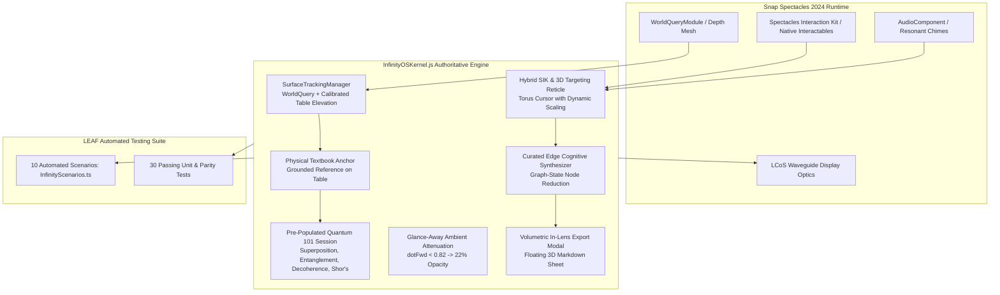

# INFINITY // Spatial Study Copilot & Ambient Knowledge Canvas

[](https://learn-specs.devpost.com/)
[](https://developers.specs.com/)
[](https://ar.snap.com/)
[](https://developers.specs.com/docs/clad)

> **Submission for Devpost Hackathon**: [Learn AR with SPECS](https://learn-specs.devpost.com/)  
> **Official Lens Studio Project**: Open [`tt/tt.esproj`](tt/tt.esproj) in Lens Studio 5.24.1  
> **Approved Design Brief**: [`devpost/design-brief.md`](devpost/design-brief.md) (mirrored in [`tt/devpost/design-brief.md`](tt/devpost/design-brief.md))  
> **Authoritative Kernel**: [`tt/Assets/InfinityOSKernel.js`](tt/Assets/InfinityOSKernel.js) (synchronized byte-for-byte with [`tt/Assets/Untitled JavaScript Component.js`](tt/Assets/Untitled%20JavaScript%20Component.js))

---

## The Spatial Computing Vision

Traditional screens trap complex academic concepts inside flat, 2D windows that demand constant tab-switching away from real textbooks and lab hardware. 

**INFINITY** transforms any physical desk into an ambient, 6DoF spatial study workstation for **Snap Spectacles AR glasses**. Concentric to the student's field of view at an ergonomic 70 cm reading distance, INFINITY anchors an interactive knowledge constellation for **Quantum Computing 101**:

1. **Draws in the World**: Powered by `SurfaceTrackingManager`, virtual study cards snap directly to physical tables using `WorldQueryModule` depth mesh hit-testing or instant elevation calibration (`[ ▲ +5cm ]`, `[ ▼ -5cm ]`, `[ ◉ Snap ]`), grounded with real-time contact shadows and a physical textbook reference marker.
2. **Pre-Populated Courseware (Quantum Computing 101)**: Boots immediately with four rich study nodes: *Qubit Superposition*, *Quantum Entanglement*, *Decoherence Noise*, and *Shor's Algorithm*, linked with dynamic 60 FPS constellation energy beams.
3. **Shares Your View**: A real-time **Constellation Solver** computes dynamic 3D orientation and distance vectors connecting dependent concepts in 3D space relative to real physical desk reference anchors.
4. **Leaves Your Body Free (Hands-Free Focus)**: Completely eliminates mid-air virtual keyboard typing fatigue in favor of hands-free voice dictation templates (`[ 🎙️ DICTATE ]`) paired with a **3D Voice HUD capsule** (`[ ✦ INFINITY // SPATIAL STUDY COPILOT ]`), allowing students to write in physical notebooks, take notes, and code simultaneously.
5. **Respects Your Attention**: A built-in **Glance-Away Ambient Attenuation Engine** automatically dims notes to 22% opacity whenever the student looks away to read a textbook or converse with a classmate, keeping the physical room primary.
6. **Native SIK & Spatial Audio**: Integrated with Spectacles Interaction Kit (SIK) `Interactable` and `Physics.ColliderComponent` architecture, paired with acoustic feedback chimes (`TriggerStartAudioTrack.wav`, `Chime_Feedback.wav`).
7. **Waveguide Optical Contrast**: Custom slate backplates with `0.94` alpha and pure white emissive typography eliminate translucent optical washout under daylight room illumination.



---

### 15° Cylindrical Curved Ergonomics & Spatial Cognitive States
- **15° Cylindrical Curved Ergonomics**: Note cards are arranged at natural reading depth ($Z = -70\text{ cm}$) angled inward towards the user head (`+14°`, `0°`, `-14°`), keeping all cards inside the 46° waveguide FOV.
- **Virtual Desk Surface**: Stand-in plate providing grounded physical reference on the table.
- **Physical Textbook Reference Marker**: Anchors an open physical textbook/lab notebook on the table surface ($X = -18\text{ cm}$, $Z = -64\text{ cm}$) to ground AR cards alongside physical course materials.
- **Spatial Cognitive States**: Notes cycle between `ANCHORED`, `SYNTHESIZING`, and `SYNCHRONIZED` states with glowing status badges and spatial audio chimes.
- **Decluttered Focus Mode**: Celestial planetary orbs automatically recede during active study mode, keeping the field of view clean and laser-focused on the desk.

## Modular Subsystems Integrated into Authoritative Kernel

1. **`SurfaceTrackingManager`**: Physical table mesh hit-testing and height calibration with contact shadows and physical textbook grounding.
2. **`Native SIK & Audio Engine`**: Dual-layer input handling binding SIK `Interactable` and `ColliderComponent` events with desktop preview raycast fallbacks and spatial audio chimes.
3. **`ShapeRecognizer & Inking`**: Geometric stroke recognizer (circles, rectangles, lines) on the whiteboard plane with automatic shape snapping.
4. **`FTUEOnboarding`**: 3-step holographic spatial tutorial guiding users through pinches and glance-away ergonomics.
5. **`Glance-Away Ambient Attenuation`**: Mathematical camera vector dot product attenuating virtual content to 22% opacity when glancing away at physical books.
6. **`LiveAIAssistantModule`**: Contextual node expansions plus one-tap `[ ✦ SUMMARIZE GRAPH ]` knowledge graph synthesis.
7. **`SessionDocumentExporter` & Volumetric In-Lens Modal**: Floating 3D markdown parchment with copy, sync, and dismiss actions.

---

## Automated Verification & Test Suite

The project includes both a Python parity/logic suite and Snap's official **LEAF (Lens Automation Framework)** test suite in TypeScript:

### Running Pytest Suite (30 Tests Passing)
```powershell
python -m pytest tests/test_lens_studio_port.py tests/test_spectacles_features.py -v
```

### LEAF Automated Scenarios (`tt/Assets/Tests/InfinityScenarios.ts`)
- **Scenario 1:** `StartupScenario` (Verifies desk plate, textbook anchor, whiteboard, 5 planets, and 4 notes)
- **Scenario 2:** `WorkspaceNavigationScenario` (Verifies voice-command navigation across workspaces)
- **Scenario 3:** `StickyNoteInteractionScenario` (Verifies 15° cylindrical arc angles)
- **Scenario 4:** `NoteStateTransitionScenario` (Verifies spatial cognitive state transitions)
- **Scenario 5:** `PersistenceScenario` (Verifies local coordinate storage integration)
- **Scenario 6:** `OnboardingScenario` (Verifies 3-step FTUE tutorial lifecycle)
- **Scenario 7:** `SessionExportScenario` (Verifies session report compilation & in-lens modal)
- **Scenario 8:** `SurfaceTrackingCalibrationScenario` (Verifies table elevation adjustment)
- **Scenario 9:** `QuantumCurriculumScenario` (Verifies pre-populated Quantum 101 courseware)
- **Scenario 10:** `GraphSynthesisScenario` (Verifies AI knowledge graph summarization)

---

## Demo Video Script (2 min 45 sec)

```
0:00 - 0:25 | THE HOOK & REAL PROBLEM
- Visual: First-person view of a physical study desk with a textbook, notebook, and laptop cluttered with 25 open tabs.
- Voiceover: "Studying complex subjects like Quantum Computing fails when ideas are trapped in flat browser tabs. You're constantly alt-tabbing away from real textbooks and physical lab materials. This is INFINITY: an ambient spatial study copilot designed specifically for Snap Spectacles."
- Action: Put on Spectacles. Instantly, INFINITY's Quantum 101 knowledge constellation boots grounded above the table at an ergonomic 70 cm.

0:25 - 0:55 | ERGONOMICS & OPTICAL PASSTHROUGH (GLANCE-AWAY)
- Visual: Camera turns slightly. Showcase the 15° cylindrical curvature keeping cards inside the 46° FOV.
- Action: Look away at the physical textbook on the desk. Notes softly dim to 22% opacity.
- Voiceover: "Unlike phone apps or floating browser screens, INFINITY respects the physical room. Notes curve naturally at arm's reach. And when the student glances away to read their physical textbook or talk to a classmate, the entire workspace softly dims to 22% opacity. The real room always stays primary."
- Action: Tap [ ▲ +5cm ] on the desk rim to calibrate elevation to the exact table height.

0:55 - 1:40 | ACTIVE LEARNING WORKFLOW & SPATIAL AUDIO
- Visual: Point at 'Qubit Superposition' — the 3D targeting reticle highlights with radiant gold.
- Action: Pinch note card. Distinct audio chime plays; note cycles from ANCHORED to SYNCHRONIZING.
- Action: Tap [ 🎙️ DICTATE ]. A new curated study note ("Quantum Teleportation channel") spawns with zero mid-air keyboard fatigue.
- Action: Tap [ ✦ SUMMARIZE GRAPH ] on the AI core orb. A central synthesis card generates, unifying all 4 concepts into a single coherent mental model.

1:40 - 2:15 | TOOLING & LEAF TESTING RIGOR
- Visual: Screen recording of Lens Studio 5.24.1 running the 10-scenario LEAF test suite with all green passes.
- Voiceover: "Engineered specifically for Snap Spectacles using the Devpost Learn skill pack, CLAD, and verified with Snap's LEAF automation framework across 10 automated test scenarios—validating 6DoF ergonomics, surface height calibration, and state persistence."

2:15 - 2:45 | VOLUMETRIC EXPORT & CLOSING VISION
- Visual: Tap Export. A floating 3D markdown parchment opens in AR space.
- Action: Tap [ 📋 SYNC DESKTOP ] to broadcast the compiled notes to the student's study companion.
- Voiceover: "When study ends, tap Export to inspect your volumetric markdown parchment and sync it directly to your study vault. INFINITY: Turning your physical desk into an infinite spatial mind."
```

---

## License & Submission Compliance

- Developed exclusively for the **Devpost Learn AR with SPECS** hackathon.
- Target Platform: Snap Spectacles (2024 / Gen 5).
- Clean repository history: zero dependencies or references to non-Spectacles platforms.
